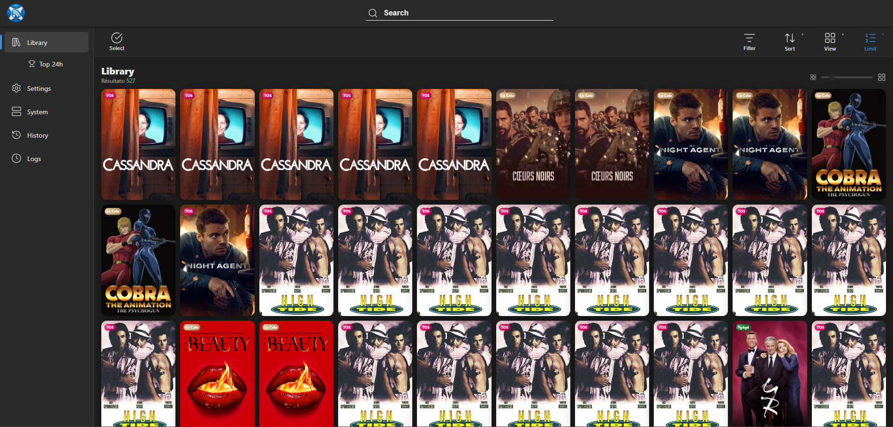
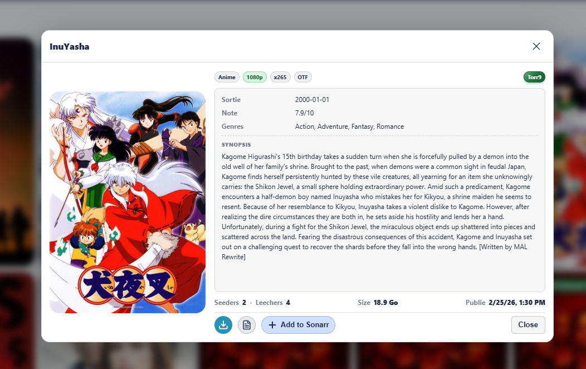
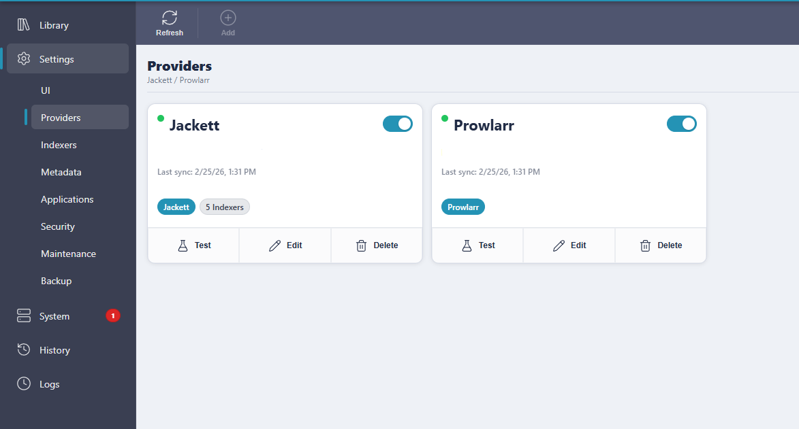

<p align="center">
  
</p>

<h1 align="center">Feedarr</h1>

<p align="center">
  <strong>Feedarr v2 — Architecture Monolithique</strong><br/>
  Feedarr fonctionne désormais en conteneur unique.<br/>
  L’ancienne architecture séparée (<code>feedarr-api</code> + <code>feedarr-web</code>) est obsolète.
</p>

<p align="center">
  Tableau intelligent de suivi des releases Torznab, Jackett et Prowlarr.
</p>

<p align="center">
  <a href="README.md">English</a> | Français (par défaut)
</p>

<p align="center">
  <a href="https://github.com/Guizmos/Feedarr/actions/workflows/docker-release.yml">
    
  </a>
  <a href="https://github.com/Guizmos/Feedarr/releases">
    
  </a>
  <a href="https://hub.docker.com/r/guizmos/feedarr">
    
  </a>
  <a href="LICENSE">
    
  </a>
</p>

<p align="center">
  <a href="#fonctionnalités">Fonctionnalités</a> |
  <a href="#installation">Installation</a> |
  <a href="#configuration">Configuration</a> |
  <a href="#développement">Développement</a> |
  <a href="#sécurité">Sécurité</a> |
  <a href="#captures-décran">Captures d’écran</a> |
  <a href="#support">Support</a> |
  <a href="#licence">Licence</a>
</p>

---

## Fonctionnalités

- Agrégation de flux Torznab via Jackett et Prowlarr
- Enrichissement des releases avec TMDB, TVmaze, Fanart, IGDB, etc.
- Affichage en bibliothèque avec posters et filtres avancés
- Gestion des providers, indexers et catégories depuis l’interface
- Intégration Sonarr / Radarr
- Système intégré de sauvegarde et restauration
- Assistant de configuration au premier lancement
- Stockage sécurisé des clés API (chiffrement au repos)
- SQLite optimisé avec pooling des connexions

---

## Installation

### Docker Compose (Monolithique)

Prérequis :

- Docker
- Docker Compose ou Portainer

```yaml
version: "3.9"

services:
  feedarr:
    container_name: FEEDARR
    image: guizmos/feedarr:latest
    restart: unless-stopped
    environment:
      ASPNETCORE_URLS: http://+:8080
      App__DataDir: /app/data
    volumes:
      - /volume1/Docker/Feedarr/data:/app/data
    ports:
      - "8888:8080"
```

Démarrage :

```bash
docker compose up -d
```

Points d’accès par défaut :

- Interface Web : `http://localhost:8888`
- API : `http://localhost:8888/api`
- Santé : `http://localhost:8888/health`

---

## Reverse Proxy

Feedarr fonctionne comme un service unique.

Configurer votre reverse proxy vers :

- `http://feedarr:8080`
- ou `http://<ip-hôte>:8888`

Le routage séparé `/api` n’est plus nécessaire.

La gestion HTTPS doit être assurée par le reverse proxy.

---

## Configuration

Au premier lancement, Feedarr reste verrouillé jusqu’à la fin de l’assistant (`/setup`).

Pour un déploiement WAN :

- Activer l’authentification
- Utiliser un reverse proxy TLS

Pages principales :

- Setup : `/setup`
- Paramètres généraux : `/settings`
- Providers : `/settings/providers`
- Services externes : `/settings/externals`
- Applications : `/settings/applications`
- Utilisateurs : `/settings/users`
- Sauvegarde / restauration : `/settings/backup`
- Indexers : `/indexers`

Guide détaillé:

- [English](docs/configuration-wizard.md)
- [Français](docs/configuration-wizard.fr.md)

---

### Intégrations Docker/LAN privées et protection SSRF

Feedarr n'accorde **aucune exception SSRF par défaut**. Pour joindre Jackett, Prowlarr, Torznab, Sonarr, Radarr, Overseerr, Jellyseerr ou Seer auto-hébergé sur un réseau Docker/LAN privé, configurez l'environnement du conteneur **avant le setup initial**.

**Mode recommandé : destinations exactes (`TrustedHosts`)**

```yaml
environment:
  App__Security__TrustedHosts__Prowlarr: "prowlarr:9696"
  App__Security__TrustedHosts__Sonarr: "sonarr:8989"
  App__Security__TrustedHosts__Radarr: "radarr:7878"
  App__Security__TrustedHosts__Jackett: "jackett:9117"
  App__Security__TrustedHosts__Seer: "10.50.0.15:5055"
```

Chaque valeur exige un nom d'hôte/IP **et un port exacts**. Les jokers et les ports implicites sont refusés. Les libellés comme `Prowlarr` sont descriptifs ; ajoutez autant d'entrées nommées distinctement que nécessaire.

**Mode avancé : sous-réseaux privés (`TrustedNetworks`)**

```yaml
environment:
  App__Security__TrustedNetworks__0: "10.50.0.0/24"
  App__Security__TrustedNetworks__1: "192.168.1.0/24"
```

**Attention : le mode réseau est moins restrictif.** Il autorise les communications des intégrations concernées vers toute destination et tout port du sous-réseau configuré. Préférez les hôtes explicites lorsque c'est possible.

Les deux modes sont cumulables dans le même bloc `environment`. Les listes sont extensibles, sans limite fixe de nombre d'entrées. Les réseaux doivent être des CIDR IPv4 RFC1918 canoniques entièrement inclus dans `10.0.0.0/8`, `172.16.0.0/12` ou `192.168.0.0/16`. Les plages publiques, les CIDR IPv6 et les CIDR contenant des bits d'hôte sont refusés au démarrage. Par exemple, utilisez `10.50.0.0/24`, pas `10.50.0.15/24`. **N'utilisez pas `172.50.0.0/24` pour créer un réseau Docker privé : cette plage est publique.**

Après modification des variables, recréez le conteneur Feedarr avec `docker compose up -d --force-recreate feedarr` (adaptez le nom du service). Un simple redémarrage du conteneur n'applique pas les variables d'environnement modifiées. Les services doivent être réellement accessibles depuis le conteneur Feedarr : réseau Docker partagé pour les noms de services, routage et pare-feu adaptés pour les IP LAN. `localhost` désigne le conteneur Feedarr lui-même et reste bloqué. Une configuration invalide empêche le démarrage ; consultez les logs du conteneur.

Les exceptions sont limitées aux clients de ces intégrations. Loopback, link-local, métadonnées cloud et destinations spéciales dangereuses restent bloqués. Les réponses DNS et les nouvelles connexions sont validées ; une redirection ne peut changer ni l'hôte ni le port. La vérification des certificats TLS reste activée par défaut. Ces options nécessitent un redémarrage de Feedarr après application du nouvel environnement du conteneur.

Un `403` portant le code `ssrf_blocked` est un refus de sécurité, pas un échec de découverte : l'ajout manuel d'un indexeur ne le contourne pas. Une source ou une application peut déjà être enregistrée avant l'échec des CAPS ou de la synchronisation initiale. Actualisez la liste, corrigez l'environnement, recréez le conteneur, puis retestez l'entrée existante plutôt que d'en créer une seconde.

**Limitation des téléchargements de releases :** ces exceptions ne s'appliquent jamais aux téléchargements, posters, métadonnées ou URL arbitraires. Feedarr relaie les téléchargements HTTP de torrents avec un client strict. Si l'URL de téléchargement d'une release pointe vers Jackett/Prowlarr privé (y compris un nom Docker résolvant vers une IP privée), son téléchargement dans Feedarr reste bloqué même si la découverte, les CAPS et le RSS fonctionnent. Aucun fallback automatique vers le navigateur n'est prévu. Une IP privée littérale est refusée à la validation de l'URL ; une réponse DNS privée est refusée avant la requête proxy. Les URL HTTP publiques restent soumises aux contrôles stricts ; les liens magnet continuent de s'ouvrir via le navigateur et le gestionnaire système. Utilisez l'interface du fournisseur pour les torrents privés lorsque disponible. Ajouter un hôte ou un sous-réseau de confiance ne supprime pas cette limitation.

---

## Développement

### Prérequis

- .NET SDK 8.x

### Lancement local (Monolithique)

```bash
dotnet run --project src/Feedarr.Api/Feedarr.Api.csproj -p:BuildWeb=true
```

Backend uniquement :

```bash
dotnet run --project src/Feedarr.Api/Feedarr.Api.csproj
```

---

## Migration depuis l’ancienne version (API + Web séparés)

1. Arrêter les anciens conteneurs
2. Supprimer les services `feedarr-api` et `feedarr-web`
3. Remplacer par le service unique `feedarr`
4. Conserver le volume `/app/data`
5. Redémarrer

Aucune migration de données requise.

---

## Sécurité

- Toutes les clés API externes sont chiffrées au repos
- Sources, Providers et applications ARR utilisent un chiffrement unifié
- Les sauvegardes anciennes et nouvelles sont compatibles
- Les credentials en clair sont automatiquement normalisés lors de la restauration
- Clés étrangères SQLite activées
- Limitation de débit sur endpoints sensibles
- Conçu pour être utilisé derrière un reverse proxy TLS

---

## Performance

- Pooling des connexions SQLite activé
- Optimisation des chemins asynchrones critiques
- Réduction des index redondants
- Amélioration de la stabilité des migrations et restaurations

---

## Captures d’écran

<table>
  <tr>
    <td></td>
    <td></td>
    <td></td>
  </tr>
</table>

---

## Support

- Issues : https://github.com/Guizmos/Feedarr/issues
- Releases : https://github.com/Guizmos/Feedarr/releases
- Documentation : `docs/`

---

## Licence

GNU GPL v3  
Voir `LICENSE` pour le texte complet.