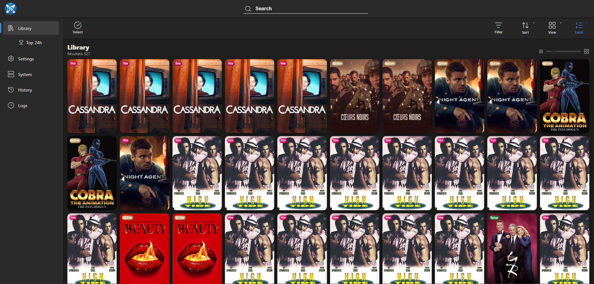
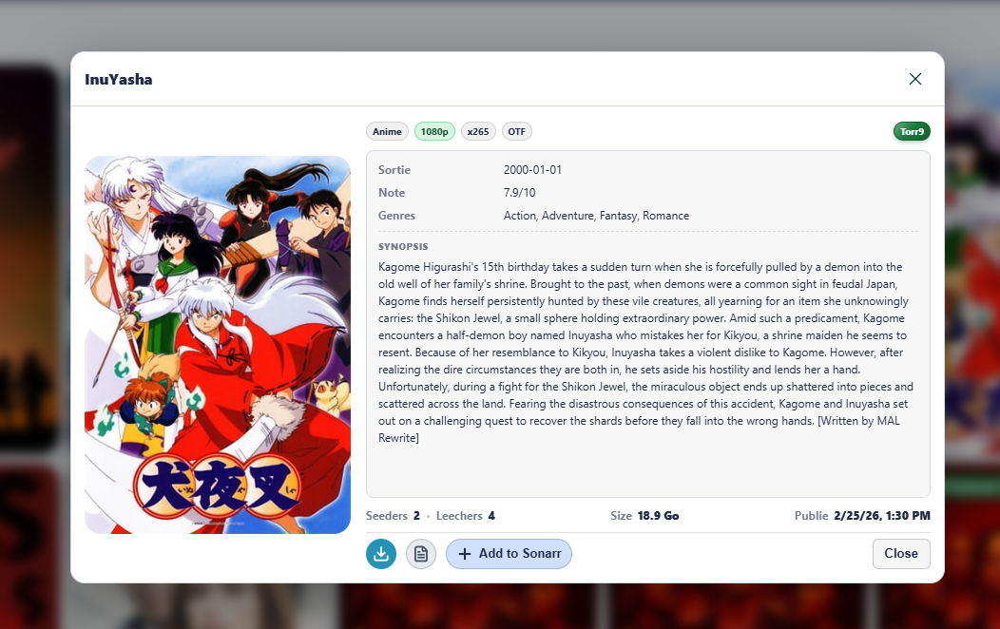
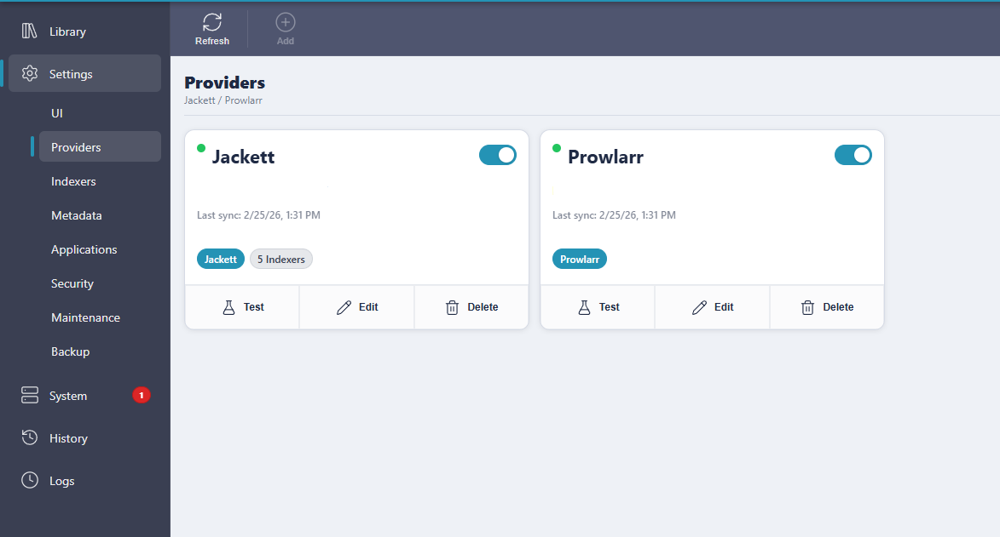

<p align="center">
  
</p>

<h1 align="center">Feedarr</h1>

<p align="center">
  <strong>Feedarr v2 — Monolithic Architecture</strong><br/>
  Feedarr is now a single-container application.<br/>
  The previous split setup (<code>feedarr-api</code> + <code>feedarr-web</code>) is deprecated.
</p>

<p align="center">
  Smart release dashboard for Torznab, Jackett and Prowlarr.
</p>

<p align="center">
  English (default) | <a href="README.fr.md">Français</a>
</p>

<p align="center">
  <a href="https://github.com/Guizmos/Feedarr/actions/workflows/docker-release.yml">
    
  </a>
  <a href="https://github.com/Guizmos/Feedarr/releases">
    
  </a>
  <a href="https://hub.docker.com/r/guizmos/feedarr">
    
  </a>
  <a href="LICENSE">
    
  </a>
</p>

<p align="center">
  <a href="#features">Features</a> |
  <a href="#installation">Installation</a> |
  <a href="#configuration">Configuration</a> |
  <a href="#development">Development</a> |
  <a href="#security">Security</a> |
  <a href="#screenshots">Screenshots</a> |
  <a href="#support">Support</a> |
  <a href="#license">License</a>
</p>

---

## Features

- Aggregate Torznab feeds from Jackett and Prowlarr
- Metadata enrichment via TMDB, TVmaze, Fanart, IGDB and others
- Poster-based library view with advanced filters
- Provider, indexer and category management from the UI
- Sonarr/Radarr integration
- Built-in backup and restore system
- First-run Setup Wizard
- Secure credential storage (encrypted at rest)
- Optimized SQLite engine with connection pooling

---

## Installation

### Docker Compose (Monolithic)

Prerequisites:

- Docker
- Docker Compose or Portainer stack support

```yaml
version: "3.9"

services:
  feedarr:
    container_name: FEEDARR
    image: guizmos/feedarr:latest
    restart: unless-stopped
    environment:
      ASPNETCORE_URLS: http://+:8080
      App__DataDir: /app/data
    volumes:
      - /volume1/Docker/Feedarr/data:/app/data
    ports:
      - "8888:8080"
```

Start:

```bash
docker compose up -d
```

Default endpoints:

- Web UI: `http://localhost:8888`
- API: `http://localhost:8888/api`
- Health: `http://localhost:8888/health`

---

## Reverse Proxy

Feedarr runs as a single upstream service.

Point your reverse proxy to:

- `http://feedarr:8080`
- or `http://<host-ip>:8888`

Separate `/api` routing is no longer required.

HTTPS redirection should be handled by the reverse proxy.

---

## Configuration

On first run, Feedarr remains locked until the Setup Wizard (`/setup`) is completed.

For WAN deployments:

- Enable authentication
- Use a TLS reverse proxy

Direct configuration pages:

- Setup: `/setup`
- General settings: `/settings`
- Providers: `/settings/providers`
- External services: `/settings/externals`
- Applications: `/settings/applications`
- Users: `/settings/users`
- Backup/restore: `/settings/backup`
- Indexers: `/indexers`

Full step-by-step guides:

- [English (default)](docs/configuration-wizard.md)
- [Français](docs/configuration-wizard.fr.md)

---

### Private Docker/LAN integrations and SSRF

Feedarr has **no SSRF exceptions by default**. To connect self-hosted Jackett, Prowlarr, Torznab, Sonarr, Radarr, Overseerr, Jellyseerr or Seer on a private Docker/LAN network, configure the container environment **before the initial setup**.

**Recommended: exact destinations (`TrustedHosts`)**

```yaml
environment:
  App__Security__TrustedHosts__Prowlarr: "prowlarr:9696"
  App__Security__TrustedHosts__Sonarr: "sonarr:8989"
  App__Security__TrustedHosts__Radarr: "radarr:7878"
  App__Security__TrustedHosts__Jackett: "jackett:9117"
  App__Security__TrustedHosts__Seer: "10.50.0.15:5055"
```

Each value requires an exact hostname/IP **and port**. No wildcards or implicit ports are accepted. Labels such as `Prowlarr` are descriptive; add more uniquely named entries as needed.

**Advanced: private networks (`TrustedNetworks`)**

```yaml
environment:
  App__Security__TrustedNetworks__0: "10.50.0.0/24"
  App__Security__TrustedNetworks__1: "192.168.1.0/24"
```

**Warning: network mode is less restrictive.** It authorizes eligible integration traffic to any destination and port in the configured subnet. Prefer exact hosts when possible.

Both modes can be combined under the same `environment` mapping. Both lists are extensible, with no fixed entry-count limit. Networks must be canonical IPv4 RFC1918 CIDRs wholly within `10.0.0.0/8`, `172.16.0.0/12` or `192.168.0.0/16`. Public networks, IPv6 CIDRs and CIDRs with host bits set are rejected at startup. For example, use `10.50.0.0/24`, not `10.50.0.15/24`. **Do not use `172.50.0.0/24` for a private Docker network: it is public address space.**

After changing environment variables, recreate the Feedarr container using `docker compose up -d --force-recreate feedarr` (adapt the service name). A simple container restart does not apply changed environment variables. Services must actually be reachable from Feedarr's container: Docker service names require a shared network; LAN addresses require routing and firewall access. `localhost` points to Feedarr's own container and remains blocked. Invalid configuration prevents startup; check container logs.

Exceptions apply only to these integration clients. Loopback, link-local, cloud metadata and dangerous special destinations stay blocked. DNS answers and new connections are validated; redirects cannot change host or port. TLS certificate verification remains enabled by default. Changing these options requires restarting Feedarr after applying the new container environment.

A `403` with code `ssrf_blocked` is a security refusal, not a discovery failure: manual indexer entry cannot bypass it. A source or application may already have been saved before its CAPS or initial synchronization fails. Refresh the list, correct the environment, recreate the container, then retest the existing entry instead of creating a duplicate.

**Release download limitation:** these exceptions never apply to downloads, posters, metadata or arbitrary URLs. Feedarr proxies HTTP torrent downloads through a strict client. If a release's download URL points to private Jackett/Prowlarr (including a Docker name resolving to a private IP), downloading it through Feedarr remains blocked even when discovery, CAPS and RSS work. There is no automatic browser fallback. Literal private URLs are rejected during URL validation; private DNS answers are rejected before the proxy request. Public HTTP download URLs remain subject to strict checks; magnet links continue to open through the browser/OS handler. Use the provider's own interface for private torrent downloads where available. Adding a trusted host or subnet does not remove this limitation.

---

## Development

### Requirements

- .NET SDK 8.x

### Run Locally (Monolithic)

```bash
dotnet run --project src/Feedarr.Api/Feedarr.Api.csproj -p:BuildWeb=true
```

Backend only:

```bash
dotnet run --project src/Feedarr.Api/Feedarr.Api.csproj
```

---

## Upgrade from Split Version

If previously using `feedarr-api` + `feedarr-web`:

1. Stop old containers
2. Remove both services
3. Replace with single `feedarr` service
4. Keep existing `/app/data` volume
5. Restart

No data migration required.

---

## Security

- All external provider API keys are encrypted at rest
- Sources, Providers and ARR applications use unified encryption
- Backup restore supports both legacy and current schema versions
- Legacy plaintext credentials are automatically normalized during restore
- SQLite foreign keys enforced
- Critical endpoints rate-limited
- Designed for reverse proxy TLS deployments

---

## Performance

- SQLite connection pooling enabled
- Async hot paths optimized
- Reduced redundant indexing
- Improved restore and migration stability

---

## Screenshots

<table>
  <tr>
    <td></td>
    <td></td>
    <td></td>
  </tr>
</table>

---

## Support

- Issues: https://github.com/Guizmos/Feedarr/issues
- Releases: https://github.com/Guizmos/Feedarr/releases
- Documentation: `docs/`

---

## License

GNU GPL v3  
See `LICENSE` for details.